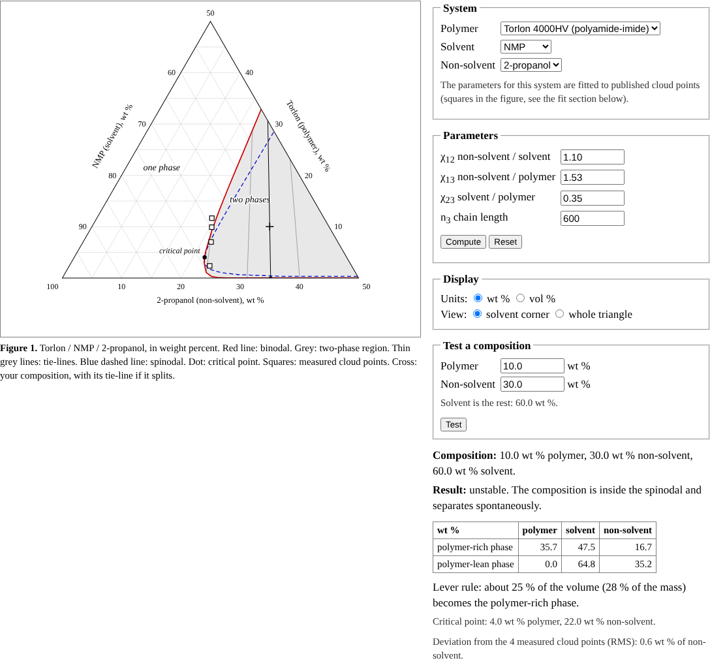

# Ternary phase diagrams

Flory-Huggins phase diagrams for polymer, solvent and non-solvent systems, the diagrams used to
plan membrane casting by phase inversion: the binodal, the spinodal, the tie-lines and the
critical point. It is a single-page browser program with no server and no libraries.

**Open the program:** https://hashimishaque.com/ternary-phase-diagrams/

## About the data

The only measured data in this repository are nine published cloud points (Ishaque 2020,
Figure 36), in `data/cloud_points.csv`: Torlon 4000HV in NMP and in DMF, titrated with
2-propanol. They were read off the published figure, so they carry about ±0.5 wt % of reading
error. Everything else comes from theory and handbook values: the
Flory-Huggins model, interaction parameters estimated from published Hansen solubility parameters,
and rough estimates for the other systems.

## What it does

- Traces the binodal by solving for equal chemical potentials in both phases, one tie-line at a
  time, from the polymer and non-solvent side to the critical point. It works with the logarithms
  of small fractions, because the polymer-lean phase can hold less than 10−300 polymer.
- Draws the spinodal, where the determinant of the second derivatives of the free energy is zero.
- For any composition you click: stable, metastable or unstable, the two phases it splits into,
  and their shares by the lever rule.
- Casting: for a dope and a coagulation bath of solvent and non-solvent, draws the mixing line
  between them, gives the cloud point of the dope, where the line enters the two-phase region, and
  the most solvent the bath can hold before the line misses it. The page explains why this is a
  guide and not the diffusion path of the film.
- Downloads the binodal, the spinodal and all tie-lines of the current diagram as CSV files, with
  every composition in wt % and in vol % and the parameters and densities in the header lines.
- For the two Torlon systems the parameters are fitted to the published cloud points. The page explains
  why the fit is not unique.

## Checks

`node checks.js` checks the solver and the fit:

| System | Largest chemical potential difference on a tie-line | Spinodal determinant at the critical point (relative) | RMS deviation from the cloud points |
|---|---|---|---|
| Torlon / NMP / 2-propanol | 7.8 × 10−11 | −1.9 × 10−5 | 0.63 wt % |
| Torlon / DMF / 2-propanol | 6.6 × 10−11 | −4.4 × 10−6 | 0.58 wt % |

The checks also read the CSV files back. The chemical potentials of the two phases in each
exported tie-line agree to better than 10−9, every exported spinodal point has a zero
determinant to 2 × 10−10 (relative), and the spinodal passes through the critical point.

For casting, the checks confirm that the cloud point of a dope without non-solvent equals the
titration cloud point used in the fit, that the entry point of a mixing line lies on the binodal,
and that the bath limit separates baths that reach the two-phase region from baths that do not.

The solver was also compared with an independent implementation in Python (SciPy): tie-lines
agree to better than 10−7 and critical points to about 3 × 10−5.

## Files

| File | Contents |
|---|---|
| `index.html` | The program, built from the files below |
| `solver.js` | Flory-Huggins solver: binodal, spinodal, tie-lines, cloud points, CSV files |
| `template.html` | The page around the solver: materials, parameters, figure, text |
| `data/cloud_points.csv` | The nine published cloud points, with their source |
| `checks.js` | The checks, for Node.js 18 or newer |
| `build.py` | Puts the page together, with its title, description and preview tags: `python3 build.py` |
| `screenshot.png`, `social.png` | Screenshot for this README, and the preview image shown when the page is shared |

## Limitations

Constant interaction parameters, no composition or temperature dependence, one chain length and no
ternary interaction term. These textbook assumptions work poorly for water-based systems, so the
water rows are only indicative.

## References

Flory, *Principles of Polymer Chemistry* (1953); Tompa, *Polymer Solutions* (1956); Altena and
Smolders, Macromolecules 15 (1982) 1491; Yilmaz and McHugh, J. Appl. Polym. Sci. 31 (1986) 997;
Romay, Diban and Urtiaga, Polymers 13 (2021) 678; Hansen, *Hansen Solubility Parameters* (2007);
Mulder, *Basic Principles of Membrane Technology* (1996); Wijmans, Baaij and Smolders, J. Membr. Sci. 14 (1983) 263;
Reuvers, van den Berg and Smolders, J. Membr. Sci. 34 (1987) 45; Reuvers and Smolders, J. Membr. Sci. 34 (1987) 67; Ishaque, *Development of novel
polymeric/inorganic composite membranes for the application in gas phase membrane reactors*,
Master's thesis, Technische Universität Hamburg (2020), https://publications.hereon.de/id/38756/.

## License

The code is MIT licensed, see `LICENSE`. The cloud points in `data/` are taken from Ishaque (2020);
please cite that source if you use them.
